# FairLease - class diagram

```mermaid
classDiagram
    direction TB

    %% ---------------- interfaces
    class Payable {
        <<interface>>
        +getId() String
        +describe() String
        +getAmountDue() double
        +isPayable() boolean
        +markPaid(LocalDate)
    }
    class Disputable {
        <<interface>>
        +getId() String
        +describe() String
        +getAmount() double
        +contest(String reason)
        +isContested() boolean
        +applyResolution(double agreedAmount)
    }
    class PhotoEvidence {
        <<interface>>
        +getPhoto() Photo
        +hasPhoto() boolean
    }

    %% ---------------- users
    class User {
        <<abstract>>
        -id, name, email, phone
        -passwordHash
        +checkPassword(String) boolean
        +getRole() Role*
    }
    class Tenant
    class Landlord {
        -iban
    }
    class CallCenterAgent
    User <|-- Tenant
    User <|-- Landlord
    User <|-- CallCenterAgent

    %% ---------------- property and agreement
    class Property {
        -address, type, surface, status
        -List~Item~ items
        +getRooms() Set~String~
        +getItemsIn(room) List~Item~
    }
    class Item {
        -room, name, category
        +isMeter() boolean
    }
    class Agreement {
        -startDate, endDate
        -monthlyRent, dueDay, depositAmount
        -Set~BillType~ includedBills
        -status
        +sign(LocalDateTime)
        +includes(BillType) boolean
        +covers(YearMonth) boolean
    }
    Landlord "1" --> "*" Property : owns
    Property "1" *-- "*" Item : inventory
    Agreement "*" --> "1" Property
    Agreement "*" --> "1" Tenant
    Agreement "*" --> "1" Landlord

    %% ---------------- inspections (photo evidence)
    class Inspection {
        -type MOVE_IN / MOVE_OUT
        -Map~String,InspectionEntry~ entriesByItem
        -submittedAt, landlordConfirmed
        +record(InspectionEntry)
        +submit(now, inventory)
        +confirmByLandlord()
        +autoAcceptIfExpired(now, hours) boolean
    }
    class InspectionEntry {
        -itemId, condition, note
        -meterReading
    }
    class Photo {
        -fileName, sha256, takenAt
    }
    Agreement "1" --> "0..2" Inspection
    Inspection "1" *-- "*" InspectionEntry
    InspectionEntry ..> Item
    InspectionEntry ..|> PhotoEvidence
    PhotoEvidence ..> Photo

    %% ---------------- money
    class Invoice {
        -type BillType, period, amount
        -status UNPAID / ON_HOLD / PAID
    }
    class Deposit {
        -amount, status
        -List~DeductionClaim~ claims
        +addClaim(DeductionClaim)
        +settle(unpaidBills, today) double
    }
    class DeductionClaim {
        -itemId, amount, reason, status
    }
    class Payment {
        -date, amount, method
        -List~String~ paidIds
    }
    Invoice ..|> Payable
    Invoice ..|> Disputable
    Invoice ..|> PhotoEvidence
    Deposit ..|> Payable
    DeductionClaim ..|> Disputable
    DeductionClaim ..|> PhotoEvidence
    Agreement "1" --> "*" Invoice
    Agreement "1" --> "1" Deposit
    Deposit "1" *-- "*" DeductionClaim
    Payment ..> Payable : pays

    %% ---------------- repairs, chat, call center
    class MaintenanceRequest {
        -description, urgency, status
        +moveTo(Status)
        +needsEscalation(now, hours) boolean
    }
    class Message {
        -senderId, sentAt, text
    }
    class Dispute {
        -topic, status, relatedId
        -proposal, proposedAmount
        +assign(agentId)
        +propose(text, amount)
        +answer(Role, boolean) boolean
    }
    class CallLogEntry {
        -at, agentId, summary
    }
    class CallCenter {
        -opensAt, closesAt
        -List~Dispute~ disputes
        -List~CallLogEntry~ callLog
        +waitingQueue() List~Dispute~
        +logCall(...)
    }
    MaintenanceRequest ..|> PhotoEvidence
    Agreement "1" --> "*" MaintenanceRequest
    Agreement "1" --> "*" Message
    CallCenter "1" *-- "*" Dispute
    CallCenter "1" *-- "*" CallLogEntry
    Dispute ..> Disputable : resolves
    CallCenterAgent "1" --> "*" Dispute : mediates

    %% ---------------- service, storage, configuration
    class FairLease {
        -Map~String,User~ users
        -Map~String,Property~ properties
        -Map~String,Agreement~ agreements
        -Map~String,Invoice~ invoices
        -Map~String,Deposit~ depositsByAgreement
        -List~Payment~ payments
        -List~Message~ messages
        +createAgreement(...) Agreement
        +startInspection(...) Inspection
        +payStatement(...) Payment
        +fileClaim(...) DeductionClaim
        +returnDeposit(...) double
        +applyAutomaticRules(now) List~String~
    }
    class FairLeaseFileStore {
        -folder
        +load(FairLease)
        +save(FairLease)
        +writeDocument(...) Path
    }
    class PhotoVault {
        -folder, maxBytes
        +importPhoto(path, takenAt) Photo
        +isIntact(Photo) boolean
    }
    class AppConfig {
        -mode, dataDir, currency
        -inspectionResponseHours
        -depositReturnDays
        -photoPolicy
        +fromArgs(String[]) AppConfig
    }
    FairLease "1" *-- "1" CallCenter
    FairLease o-- User
    FairLease o-- Property
    FairLease o-- Agreement
    FairLease --> AppConfig
    FairLeaseFileStore ..> FairLease : saves / loads
    PhotoVault ..> Photo : creates

    %% ---------------- console user interface
    class RoleMenu {
        <<abstract>>
        +run()
        #handle(int)*
    }
    class PartyMenu {
        <<abstract>>
        #chat()
        #callCenter()
    }
    class TenantMenu
    class LandlordMenu
    class AgentMenu
    class FairLeaseApp
    class ConsoleInput
    class InputRules
    RoleMenu <|-- PartyMenu
    PartyMenu <|-- TenantMenu
    PartyMenu <|-- LandlordMenu
    RoleMenu <|-- AgentMenu
    FairLeaseApp ..> RoleMenu : opens
    RoleMenu --> FairLease
    RoleMenu --> ConsoleInput
    ConsoleInput ..> InputRules : validates with

    %% ---------------- custom exceptions
    class InvalidInputException
    class UnfairClaimException
    class AgreementStateException
    Exception <|-- InvalidInputException
    Exception <|-- UnfairClaimException
    Exception <|-- AgreementStateException
    InputRules ..> InvalidInputException : throws
    Deposit ..> UnfairClaimException : throws
    Agreement ..> AgreementStateException : throws
```

Enums nested in the classes above (not drawn): `Role`, `BillType`, `Condition`, `Property.Type/Status`,
`Item.Category`, `Agreement.Status`, `Inspection.Type`, `Invoice.Status`, `Payment.Method`, `Deposit.Status`,
`DeductionClaim.Status`, `MaintenanceRequest.Urgency/Status`, `Dispute.Topic/Status`, `AppConfig.Mode/PhotoPolicy`.
